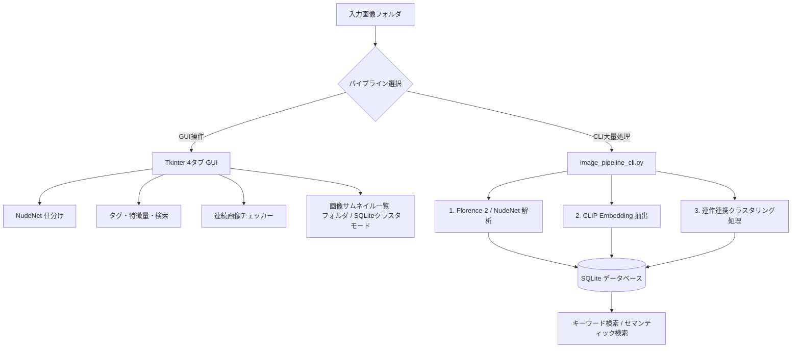
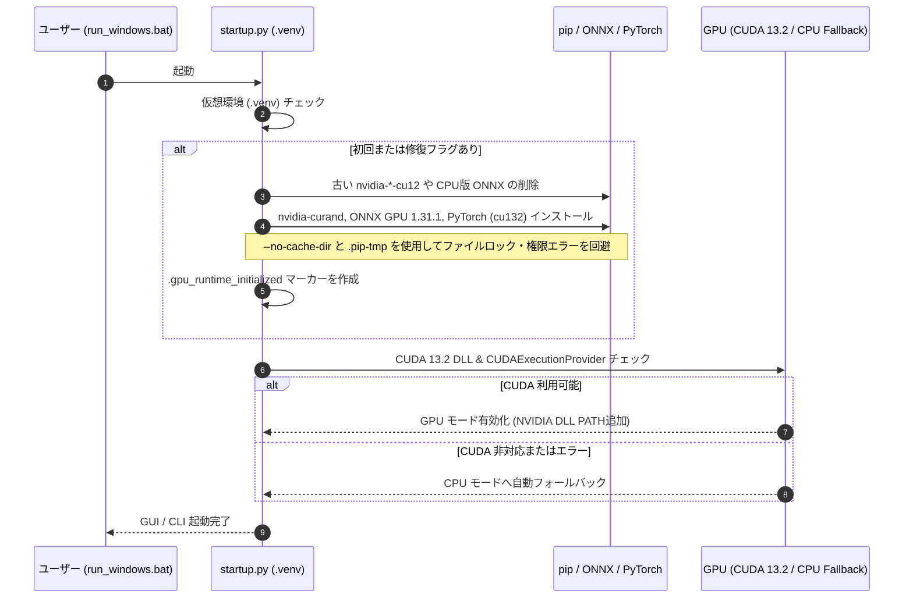

# Twitter Image Sorter  (ローカル画像自動整理・検索パイプライン)

数万枚規模のローカル画像（イラスト・写真など）を完全ローカル環境で自動判定・仕分けし、AIによる詳細キャプション生成・ベクトル検索（CLIP）・クラスタリング・重複処理・GUI閲覧を高速かつシームレスに行うためのオールインワンパッケージです。

---

## 💡 主な機能 (Key Features)

- **自動判定・仕分け (NudeNet 3.4.2)**: センシティブ判定やルールベース（`.trashed-` 始まりや `image(1).jpg` 等の重複形式）の自動整理・クリーンアップ。
- **キャプション生成 (Florence-2)**: `florence-community/Florence-2-base` を用いた高精度な画像記述のローカル生成（`timm`, `einops` 対応）。
- **ベクトル抽出・クラスタリング (CLIP)**: 絵柄や構図の特徴量を数値化（Embedding）し、K-means等の類似クラスタリング（例: 40グループへの分類）を実行。連作・連続画像グループを1単位として扱ったまとまりのあるクラスタリングに対応。
- **キーワード＆意味検索 (Semantic Search)**: データベースに蓄積されたキャプション検索に加え、日本語の自然言語クエリをローカルで英語ベクトル化し、類似画像を高速検索。
- **連番・分割画像検出**: 更新日時（10秒以内）、高さ誤差（1%以内）、画像の境界スコアを評価し、パノラマ・分割投稿されたイラスト（最大4枚）の自動グループ化や並び替えをサポート。
- **高速サムネイル閲覧 GUI (Tkinter)**: 画面表示範囲＋前後3行のみを動的にキャッシュする軽量設計。フォルダ切り替えに加え、SQLiteクラスタごとの閲覧や独自SQLフィルタリング表示にも対応。

---

## 🏗️ システム構造 & 処理パイプライン (Architecture)

### 1. 全体データフロー



### 2. GPU環境の自動判定・自動復旧ロジック (`startup.py`)

CUDA 13.2 / cuDNN 9 ランタイムと `onnxruntime-gpu==1.31.1` / PyTorch (`cu132`) を統一環境として自動構築・検証します。Windows特有の権限問題（`WinError 5`）や古いCUDA 12ホイールの干渉を自動回避するセルフヘルスチェック機能を搭載しています。



---

## 🚀 動作環境とセットアップ (Setup)

### 前提条件
- **OS**: Windows 10 / 11 (64-bit)
- **Python**: **3.11** または **3.12**
- **GPU（任意）**: NVIDIA グラフィックボード（最新の NVIDIA ディスプレイドライバ と [Microsoft Visual C++ Runtime](https://learn.microsoft.com/en-us/cpp/windows/latest-supported-vc-redist) を事前にインストールしてください）

### 簡単スタート手順
1. 本リポジトリのZIPを解凍します。
2. `run_windows.bat` をダブルクリックします。
3. 初回起動時はセットアップウィンドウが立ち上がり、不足パッケージのインストールと `.venv` の構築、CUDA 13.2環境の初期化が自動で行われます。
4. 入力元（Source）フォルダと出力先（Output）フォルダを指定して使用を開始します。

---

## 💻 CLIコマンドの使い方 (Command Line Interface)

大量の画像をバックグラウンドで一括処理する場合、GUIを介さないCLIコマンドが最適です。

### 1. 依存ライブラリのセットアップ (初回のみ)
```bash
python -m pip install torch transformers
```
*(※ Florence-2 に必要な `timm` と `einops` はセットアップ時に自動インストールされます)*

### 2. 画像解析・データベース登録 (Analyze & Tag)
```bash
python image_pipeline_cli.py analyze "D:\images" --database "D:\images.sqlite3"
```

### 3. Florence-2 キャプション生成 (Captioning)
```bash
python image_pipeline_cli.py caption "D:\images" --database "D:\images.sqlite3"
```

### 4. 画像のクラスタリング (Clustering)
連続画像チェッカーで検出された連作グループは1つの単位としてまとめてクラスタリングされます。
```bash
# 例: 画像を40個のグループに分類
python image_pipeline_cli.py cluster --database "D:\images.sqlite3" --clusters 40
```

### 5. 画像検索 (Search)
```bash
# キーワード高速検索 (ローカルDB検索)
python image_pipeline_cli.py search "ケモノ 背景 線画" --database "D:\images.sqlite3"

# CLIP意味検索 (日本語クエリを自動翻訳してベクトル類似度検索)
python image_pipeline_cli.py search "a furry character in a forest" --semantic --database "D:\images.sqlite3"
```

---

## 🖥️ GUI機能の紹介 (GUI Tabs)

GUIは4つのタブで構成されています。バックグラウンド処理に対応しており、進捗状況が表示されます。

| タブ名 | 機能概要 |
| :--- | :--- |
| **NudeNet仕分け** | 不要なファイル名（`image(1).jpg` や `.trashed-`）の自動削除プレビュー＆判定、NSFWスコアに基づく自動分類。 |
| **タグ・特徴量・検索** | CLIP解析、Florence-2キャプション生成、クラスタリング、キーワード・NSFWスコア検索。検索結果は上位20グループまでマウスホイール等で確認可能。 |
| **連続画像チェッカー** | 更新日時と画像境界の一致度から最大4枚の連続画像を検出・グループ化。手動追加、グループ解除、並び順 (`sequence_index`) の調整・保存が可能。 |
| **画像サムネイル一覧** | 1行あたり1〜12枚の正方形サムネイル表示。「表示元」を `フォルダ` と `SQLiteクラスタ` で切替可能。クラスタモードではSQL条件指定（`path` カラムを返すSELECT文など）や「再分類」ボタンによるリアルタイム再クラスタリングに対応。 |

---

## 🔧 トラブルシューティング & 環境変数

- **GPU環境の再構築・修復**:
  CUDA 13.2 / ONNX Runtime のパッケージ構成を再構築したい場合は、環境変数を設定して起動します。
  ```cmd
  set TWITTER_SORTER_FORCE_GPU_REPAIR=1
  run_windows.bat
  ```
- **CPUフォールバック**:
<<<<<<< HEAD
  NVIDIA環境がない場合、またはCUDAエラーが発生した場合は、自動的に安全なCPU処理モードへと移行します（データベース構造の互換性は完全に維持されます）。
=======
  NVIDIA環境がない場合、またはCUDAエラーが発生した場合は、自動的に安全なCPU処理モードへと移行します（データフォーマットの互換性は完全に維持されます）。
>>>>>>> c06dcc73463000e539eb4e843a8bb69487fe0f44
