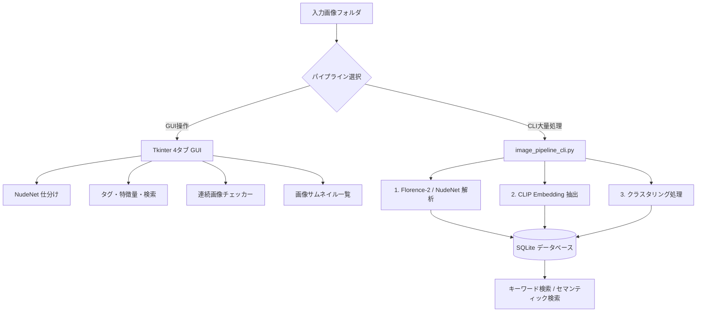
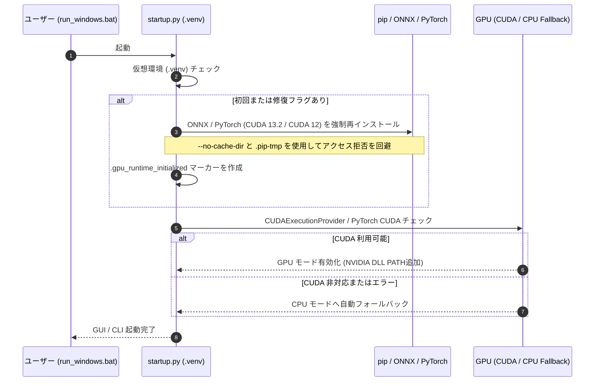

# Twitter Image Sorter Minimal (ローカル画像自動整理・検索パイプライン)

数万枚規模のローカル画像（イラスト・写真など）を完全ローカル環境で自動判定・仕分けし、AIによる詳細キャプション生成・ベクトル検索（CLIP）・クラスタリング・重複処理・GUI閲覧を高速かつシームレスに行うためのオールインワンパッケージです。

---

## 💡 主な機能 (Key Features)

- **自動判定・仕分け (NudeNet 3.4.2)**: センシティブ判定やルールベースの自動整理。
- **キャプション生成 (Florence-2)**: `florence-community/Florence-2-base` を用いた高精度な画像記述のローカル生成。
- **ベクトル抽出・クラスタリング (CLIP)**: 絵柄や構図の特徴量を数値化（Embedding）し、K-means等の類似クラスタリング（例: 40グループへの分類）を実行。
- **キーワード＆意味検索 (Semantic Search)**: データベースに蓄積されたキャプション検索に加え、日本語の自然言語クエリをローカルで英語ベクトル化し、類似画像を高速検索。
- **連番・分割画像検出**: 更新日時や画像の境界スコアを評価し、パノラマ・分割投稿されたイラストの自動グループ化や並び替えをサポート。
- **高速サムネイル閲覧 GUI (Tkinter)**: 画面表示範囲の可視領域のみを動的にキャッシュし、数万枚のフォルダもメモリを抑えて高速レンダリング。

---

## 🏗️ システム構造 & 処理パイプライン (Architecture)

### 1. 全体データフロー



### 2. GPU環境の自動判定・自動復旧ロジック (`startup.py`)

Windows特有の権限問題（`WinError 5`）やCUDA DLL依存を自動回避するセルフヘルスチェック機能を搭載しています。



---

## 🚀 動作環境とセットアップ (Setup)

### 前提条件
- **OS**: Windows 10 / 11 (64-bit)
- **Python**: 3.10 または 3.11
- **GPU（任意）**: NVIDIA グラフィックボード（最新の NVIDIA ディスプレイドライバ と [Microsoft Visual C++ Redistributable](https://learn.microsoft.com/en-us/cpp/windows/latest-supported-vc-redist) を事前にインストールしてください）

### 簡単スタート手順
1. 本リポジトリのZIPを解凍します。
2. `run_windows.bat` をダブルクリックします。
3. 初回起動時はセットアップウィンドウが立ち上がり、不足パッケージのインストールと `.venv` の構築、CUDA環境の初期化が自動で行われます。
4. 入力元（Source）フォルダと出力先（Output）フォルダを指定して使用を開始します。

---

## 💻 CLIコマンドの使い方 (Command Line Interface)

大量の画像をバックグラウンドで一括処理する場合、GUIを介さないCLIコマンドが最適です。

### 1. 画像解析・データベース登録 (Analyze & Tag)
```bash
python image_pipeline_cli.py analyze "D:\images" --database "D:\images.sqlite3"
```

### 2. Florence-2 キャプション生成 (Captioning)
```bash
python image_pipeline_cli.py caption "D:\images" --database "D:\images.sqlite3"
```

### 3. 画像のクラスタリング (Clustering)
```bash
# 例: 画像を40個のグループに分類
python image_pipeline_cli.py cluster --database "D:\images.sqlite3" --clusters 40
```

### 4. 画像検索 (Search)
```bash
# キーワード高速検索 (ローカルDB検索)
python image_pipeline_cli.py search "ケモノ 背景 線画" --database "D:\images.sqlite3"

# CLIP意味検索 (日本語クエリを自動翻訳してベクトル類似度検索)
python image_pipeline_cli.py search "a furry character in a forest" --semantic --database "D:\images.sqlite3"
```

---

## 🖥️ GUI機能の紹介 (GUI Tabs)

GUIは4つのタブで構成されています。

| タブ名 | 機能概要 |
| :--- | :--- |
| **NudeNet仕分け** | 不用品ファイル名（`image(1).jpg` や `.trashed-`）のクリーンアップ、NSFWスコアに基づく自動分類。 |
| **タグ・特徴量・検索** | DBに格納されたCLIPベクトル、Florence-2のキャプション、クラスタID、NSFWスコアを複合検索。 |
| **連続画像チェッカー** | 連番や境界スコアから4分割・連続画像を検出・連結並び替え。手動グループ追加機能も搭載。 |
| **画像サムネイル一覧** | 1行あたり1〜12枚の可変グリッド。可視領域＋前後3行のみをメモリ保持し、高速レスポンスを実現。 |

---

## 🔧 トラブルシューティング & 環境変数

- **GPU環境の再構築・修復**:
  環境移行などでGPUが正しく認識されなくなった場合、以下のコマンドを設定してから起動することでGPU環境の初期化を強制再実行できます。
  ```cmd
  set TWITTER_SORTER_FORCE_GPU_REPAIR=1
  run_windows.bat
  ```
- **CPUフォールバック**:
  NVIDIA環境がない場合、またはCUDAエラーが発生した場合は、自動的に安全なCPU処理モードへと移行します（データフォーマットの互換性は完全に維持されます）。